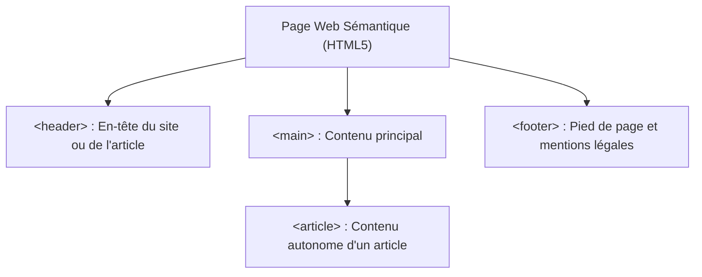

## 1. Objectif

Dans ce tutoriel de clôture de la session S1, vous allez réaliser votre première **veille prospective** pour préparer le travail technique de la session S2 : la création de la page Article en HTML5 et CSS3.

Vous allez apprendre à :
* comprendre l'intérêt du balisage sémantique en **HTML5** ;
* découvrir comment **CSS3** transforme un document brut en interface soignée ;
* concevoir une slide de veille prospective respectant les 4 critères du standard Spartel N1 ;
* présenter votre synthèse en 3 minutes maximum.

## 2. Prérequis

* Avoir suivi les tutoriels de l'unité [UA.161.11 — Découvrir le Web et les langages](/tutos/partage-google-slides/).
* Savoir modifier et partager sa présentation Google Slides.

---

## Partie 1 — Théorie

### 1.1. Pourquoi une veille prospective ?

Une **veille prospective** consiste à explorer une technologie **avant** de l'utiliser en atelier pratique.
Elle vous permet :
* d'arriver au sprint suivant avec des repères clairs ;
* de comprendre le sens des balises et des règles de style dès la première démonstration ;
* de poser des questions pertinentes au formateur.

### 1.2. HTML5 : Le pouvoir de la sémantique

Avant HTML5, toutes les zones d'une page étaient construites avec des balises génériques sans signification (`<div>`, `<div>`, `<div>`).
HTML5 a introduit des **balises sémantiques** qui indiquent clairement le rôle de chaque bloc :



Ces balises facilitent la lecture du code, améliorent le référencement naturel (SEO) et rendent le site accessible aux personnes malvoyantes.

### 1.3. CSS3 : Séparer le fond de la forme

CSS3 permet d'isoler l'apparence visuelle dans un fichier séparé :
* Si vous souhaitez changer la couleur ou la police de tout le site, vous modifiez une seule ligne de CSS sans toucher au HTML.
* Il offre un contrôle précis des espacements (`margin`, `padding`), des couleurs (`color`, `background-color`) et de la typographie.

---

## Partie 2 — Pratique

### 2.1. Travail à faire : Concevoir la slide de veille HTML5 / CSS3

Dans votre présentation Google Slides partagée, créez **une slide unique** consacrée à votre veille prospective.

**Contenu obligatoire de votre slide (les 4 critères N1) :**
1. **Nom et logos :** HTML5 et CSS3.
2. **Définition simple (1 phrase) :** Exemple : *« HTML5 et CSS3 sont les standards du Web qui permettent de structurer le contenu avec du sens et de styliser son apparence visuelle. »*
3. **Le problème concret résolu :** Pourquoi est-il indispensable de séparer le contenu (HTML) du design (CSS) plutôt que de tout mélanger ?
4. **Trois mots-clés essentiels :** *Balise sémantique* — *Sélecteur CSS* — *Séparation fond/forme*.

### 2.2. Livrable attendu

1. Mettez à jour votre présentation Google Slides avec cette slide de veille.
2. Dans votre dépôt d'autoformation, créez le fichier de synthèse :

```text
veille/prospective/bases-html5-css3/slide.md
```

**Contenu de votre fichier `slide.md` :**
```markdown
# Veille Prospective : Bases de HTML5 et CSS3

- **Auteur :** [Votre Prénom et Nom]
- **Session préparée :** S2 — Page Article (HTML/CSS)
- **Lien public de la présentation :** [Coller ici votre URL Google Slides]

## Résumé de ma veille
- **Technologie :** HTML5 & CSS3
- **Problème résolu :** Séparer la structure sémantique du contenu et son style visuel
- **Points clés retenus pour S2 :**
  1. Utiliser `<header>`, `<article>`, `<section>` au lieu de simples `<div>`.
  2. Créer un fichier `style.css` externe propre.
  3. Comprendre la relation entre un sélecteur CSS et une balise HTML.
```

Commitez et poussez votre fichier sur votre dépôt GitHub.

### Critères de réussite

* La slide de veille prospective comporte les 4 critères imposés.
* Vous êtes capable de résumer oralement votre veille en **3 minutes chrono**.
* Le fichier `slide.md` est commité dans votre dépôt d'autoformation.

---

## Bilan

* Vous avez réalisé votre première veille prospective en autonomie.
* Vous abordez la session S2 avec des repères solides sur la sémantique HTML5 et les principes du style CSS3.
* Ce rituel de veille vous accompagnera à chaque session pour préparer le défi technique suivant.

## Glossaire

* **Veille prospective** : Recherche documentaire préparatoire sur une compétence à acquérir au prochain sprint.
* **Sémantique** : Sens donné à une balise pour décrire la nature de son contenu (ex: `<article>` indique un article de presse ou de blog).
* **Sélecteur CSS** : Expression indiquant à quelle balise HTML s'appliquent les règles de style (ex: `p`, `.titre`, `#menu`).