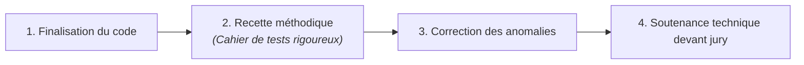

## 1. Objectif

Dans ce tutoriel de **veille technologique** de la session S11, vous allez explorer un nouveau sujet technique clé pour votre formation.

Cette veille technologique a pour but de vous préparer au défi technique de la session suivante : **S12 — Recette finale, soutenance et bilan de formation**.

Vous allez apprendre à :
* comprendre le contexte et l'importance du sujet pour l'évolution de l'application Blog ;
* identifier les notions techniques fondamentales de la technologie étudiée ;
* concevoir votre slide de veille technologique selon les 4 critères imposés ;
* préparer votre restitution orale de 3 minutes.

## 2. Prérequis

* Avoir suivi la session précédente et maîtriser la présentation Google Slides ([T.161.111](/tutos/partage-google-slides/)).
* Être prêt à mener une recherche documentaire en autonomie.

---

## Partie 1 — Contexte & Importance du Sujet

### 1.1. Pourquoi ce sujet est-il crucial pour la suite du projet ?

Votre application de Blog est désormais presque complète. Mais un bon développeur ne livre jamais son code sans avoir rigoureusement vérifié qu'aucun bug ne subsiste.

En session S12, vous vivrez deux étapes professionnelles décisives :
1. **La Recette applicative (Cahier de tests) :** dérouler méthodiquement une liste de scénarios d'utilisation pour valider chaque fonctionnalité (inscription, connexion, création d'article, recherche, cas limites).
2. **La Soutenance technique :** présenter votre travail devant un jury professionnel, expliquer vos choix d'architecture, faire une démonstration fluide et répondre avec assurance aux questions techniques.

### 1.2. Schéma de compréhension



---

## Partie 2 — Travail à Réaliser (Autonomie de l'Apprenant)

### 2.1. Votre mission de veille technologique

À l'aide de vos recherches documentaires (documentations officielles, tutoriels de référence), explorez le sujet puis concevez **une seule slide synthétique** dans votre présentation Google Slides de veille technologique.

**Votre slide doit obligatoirement respecter les 4 critères du standard de veille technologique Spartel N1 :**

1. **Nom de la technologie et logo officiel.**
2. **Définition simple (en une seule phrase accessible) :**  
   Définissez ce qu'est une recette logicielle et l'intérêt d'un scénario de test pour fiabiliser un produit.
3. **Le problème technique concret résolu :**  
   Expliquez pourquoi une démonstration technique improvisée sans préparation de soutenance mène presque toujours à des imprévus.
4. **Trois mots-clés ou caractéristiques clés :**  
   Exemples : *Cahier de recette — Tests de non-régression — Scénario de soutenance*.

### 2.2. Préparation de la restitution orale

Vous présenterez votre slide de veille technologique devant votre formateur ou vos pairs en **3 minutes maximum** :
* **Minute 1 :** Présentez le sujet et donnez votre définition simple.
* **Minute 2 :** Expliquez le problème concret que cela résout pour le projet de Blog.
* **Minute 3 :** Citez vos 3 mots-clés et concluez sur ce que cela vous apporte pour le prochain sprint.

### 2.3. Livrable attendu

Dans votre dépôt annuel de travail, créez le fichier de traçabilité suivant :

```text
veille/technologique/recette-soutenance/slide.md
```

**Contenu de votre fichier `slide.md` :**
```markdown
# Veille technologique : Recette applicative et soutenance

- **Auteur :** [Votre Prénom et Nom]
- **Session de réalisation :** S11
- **Session préparée :** S12 — Recette finale, soutenance et bilan de formation
- **Lien public de la slide :** [Coller ici votre URL Google Slides accessible en mode Lecteur]

## Synthèse de ma veille technologique
- **Définition en une phrase :** [Votre phrase simple]
- **Problème résolu pour le projet :** [Pourquoi cet outil ou concept est indispensable]
- **Mes 3 mots-clés :** [Mot-clé 1] — [Mot-clé 2] — [Mot-clé 3]
```

Commitez et poussez votre fichier sur votre dépôt GitHub.

### Critères de réussite

* Votre slide de veille technologique est finalisée sur Google Slides avec un lien public accessible en lecture seule.
* Les 4 critères de contenu sont clairement identifiables en un coup d'œil.
* Vous êtes capable d'expliquer oralement l'intérêt de la technologie en 3 minutes chrono.
* Le fichier `slide.md` est commité dans votre dépôt d'autoformation à l'emplacement indiqué.

---

## Bilan

* Vous avez mené une démarche de **veille technologique** en autonomie pour préparer votre prochaine étape d'apprentissage.
* L'anticipation des concepts techniques vous permet d'aborder les ateliers pratiques avec confiance et curiosité.
* Cette autonomie documentaire constitue une compétence clé tout au long de votre parcours de développeur.

## Glossaire

* **Veille technologique** : Démarche méthodique d'information et d'exploration de technologies pour anticiper les évolutions et les défis d'un projet informatique.
* **Recette logicielle** : Phase de vérification formelle validant la conformité d'une application avec ses exigences initiales.
* **Cahier de tests** : Document décrivant la suite d'actions à réaliser et le résultat attendu pour chaque cas de test.
* **Soutenance technique** : Présentation orale et démonstration du produit fini devant des évaluateurs ou un jury professionnel.
