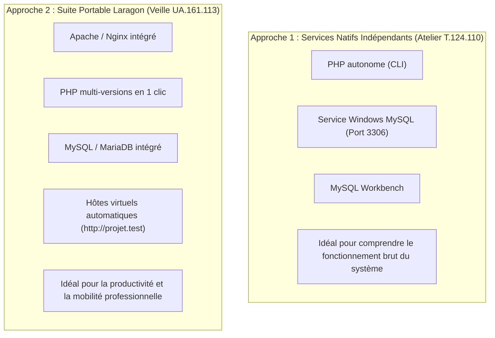

## 1. Objectif

Dans ce tutoriel de **veille technologique** de la session S6, vous allez explorer un outil d'environnement de travail très populaire parmi les développeurs Web sous Windows : **Laragon**.

Dans le tutoriel pratique T.124.110, vous avez installé MySQL Server directement comme service Windows natif avec MySQL Workbench pour comprendre le fonctionnement sous-jacent d'un SGBDR.  
Dans cette veille, vous allez découvrir une approche alternative : les **suites de développement local tout-en-un et portables**.

Vous allez apprendre à :
* comprendre le rôle et les fonctionnalités clés de Laragon ;
* identifier ses différences par rapport à des services natifs et des suites historiques lourdes (XAMPP, WampServer) ;
* concevoir votre slide de veille technologique selon les 4 critères imposés ;
* préparer votre restitution orale de 3 minutes.

## 2. Prérequis

* Avoir suivi le tutoriel T.124.110 (installation native de MySQL Server et MySQL Workbench).
* Être prêt à mener une recherche documentaire en autonomie sur le site officiel [https://laragon.org/](https://laragon.org/).

---

## Partie 1 — Contexte & Importance du Sujet

### 1.1. Pourquoi explorer Laragon ?

Sur Windows, un développeur Web PHP/MySQL a besoin de plusieurs composants pour travailler :
1. Un serveur Web (Apache ou Nginx).
2. Un interpréteur PHP.
3. Un serveur de base de données relationnelle (MySQL ou MariaDB).
4. Un outil graphique d'administration (phpMyAdmin, HeidiSQL ou Workbench).

Configurer chacun de ces composants manuellement et modifier les variables d'environnement système peut s'avérer complexe lors du changement rapide de projet.

**Laragon** propose une solution moderne, légère et isolée :
* **Installation ultra-rapide et légère :** Ne pollue pas le registre Windows et peut fonctionner en mode 100% portable (sur une clé USB ou un dossier isolé).
* **Virtual Hosts automatiques :** Crée automatiquement une adresse locale élégante pour chaque projet (ex: un dossier `mon-blog` devient immédiatement accessible via `http://mon-blog.test` sans configuration DNS manuelle).
* **Changement de version en un clic :** Permet de basculer instantanément entre plusieurs versions de PHP (PHP 7.4, 8.1, 8.2, 8.3) ou de MySQL selon les besoins du projet.

### 1.2. Schéma comparatif



---

## Partie 2 — Travail à Réaliser (Autonomie de l'Apprenant)

### 2.1. Votre mission de veille technologique

À l'aide de vos recherches documentaires (site officiel [laragon.org](https://laragon.org/), retours de développeurs), explorez l'outil puis concevez **une seule slide synthétique** dans votre présentation Google Slides de veille technologique.

**Votre slide doit obligatoirement respecter les 4 critères du standard de veille technologique Solicode N1 :**

1. **Nom de l'outil et logo officiel :** *Laragon*.
2. **Définition simple (en une seule phrase accessible) :**  
   Expliquez ce qu'est Laragon et pourquoi il est qualifié d'environnement de développement local portable.
3. **Le problème technique concret résolu :**  
   Expliquez pourquoi Laragon simplifie la vie du développeur sous Windows par rapport à l'installation séparée de chaque service ou à des suites plus lourdes.
4. **Trois mots-clés ou caractéristiques clés :**  
   Exemples : *Virtual Hosts automatiques (.test) — Portabilité (zéro pollution Windows) — Bascule multi-versions PHP/MySQL*.

### 2.2. Préparation de la restitution orale

Vous présenterez votre slide de veille technologique devant votre formateur ou vos pairs en **3 minutes maximum** :
* **Minute 1 :** Présentez Laragon et donnez votre définition simple en une phrase.
* **Minute 2 :** Expliquez les avantages concrets (Virtual Hosts automatiques, isolation, portabilité) comparés aux installations manuelles.
* **Minute 3 :** Citez vos 3 mots-clés et partagez votre avis sur l'intérêt de cet outil pour vos futurs projets Web.

### 2.3. Livrable attendu

Dans votre dépôt annuel de travail, créez le fichier de traçabilité suivant :

```text
veille/technologique/decouvrir-laragon/slide.md
```

**Contenu de votre fichier `slide.md` :**
```markdown
# Veille technologique : Découvrir Laragon et les environnements de développement local

- **Auteur :** [Votre Prénom et Nom]
- **Session de réalisation :** S6 — Connecter la page d'accueil à MySQL
- **Unité d'Apprentissage :** UA.161.113
- **Outil exploré :** Laragon (laragon.org)
- **Lien public de la slide :** [Coller ici votre URL Google Slides accessible en mode Lecteur]

## Synthèse de ma veille technologique
- **Définition en une phrase :** [Votre phrase simple définissant Laragon]
- **Problème résolu pour le développeur :** [Pourquoi cet outil améliore le confort et la productivité]
- **Mes 3 mots-clés :** [Mot-clé 1] — [Mot-clé 2] — [Mot-clé 3]
```

Commitez et poussez votre fichier sur votre dépôt GitHub.

### Critères de réussite

* [ ] Votre slide de veille technologique sur Laragon est finalisée sur Google Slides avec un lien public accessible en lecture seule.
* [ ] Les 4 critères de contenu (nom/logo, définition courte, problème résolu, 3 mots-clés) sont clairement lisibles.
* [ ] Vous êtes capable d'expliquer oralement l'intérêt de Laragon en 3 minutes chrono.
* [ ] Le fichier `slide.md` est commité dans votre dépôt d'autoformation à l'emplacement indiqué sans capture d'écran.

---

## Bilan

* Vous avez découvert une solution d'outillage alternative moderne et largement adoptée dans le monde professionnel sous Windows.
* Comprendre à la fois les services natifs (approche atelier) et les suites automatisées comme Laragon (approche veille) enrichit votre culture technique de développeur.
* Cette double vision vous permet de choisir l'environnement le plus adapté selon le contexte de vos futurs projets et clients.

## Glossaire

* **Laragon** : Environnement de développement Web rapide, universel et portable pour Windows intégrant Apache, Nginx, PHP, MySQL, MariaDB et des outils de gestion.
* **Virtual Host** : Configuration d'un serveur Web permettant de faire pointer un nom de domaine local simplifié (ex: `http://mon-blog.test`) vers un dossier spécifique de votre machine.
* **Portabilité** : Propriété d'un logiciel capable de fonctionner sans installation intrusive dans le registre Windows, facilitant son déplacement sur une clé USB ou un autre disque.
* **WAMP / LAMP** : Piles logicielles regroupant un système d'exploitation (Windows/Linux), un serveur Web (Apache), un SGBDR (MySQL) et un langage de script (PHP).
