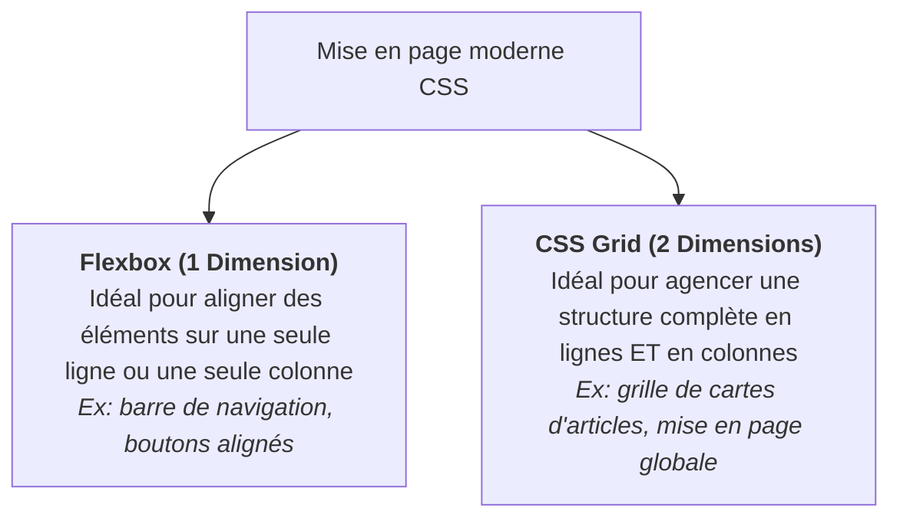

## 1. Objectif

Dans ce tutoriel de veille prospective de la session S2, vous allez explorer les deux technologies modernes d'agencement visuel du Web : **CSS Flexbox** et **CSS Grid**.

Cette veille a pour but de vous préparer au défi technique de la session S3 : **l'affichage d'une grille d'articles responsive pour la page d'accueil du Blog**.

Vous allez apprendre à :
* comprendre pourquoi Flexbox et Grid ont remplacé les anciennes méthodes de mise en page ;
* identifier la différence fondamentale entre la disposition à une dimension (Flexbox) et à deux dimensions (Grid) ;
* réaliser votre slide de veille synthétique selon les 4 critères imposés ;
* préparer votre restitution orale de 3 minutes.

## 2. Prérequis

* Avoir suivi la session S1 et maîtriser la création d'une slide partagée sur Google Slides ([T.161.111](/tutos/partage-google-slides/)).
* Avoir découvert les premières règles de style CSS en session S2.

---

## Partie 1 — Contexte & Importance du Sujet

### 1.1. Pourquoi ce sujet est-il crucial pour la session S3 ?

En session S2, vous mettez en page un article unique : les blocs s'empilent naturellement les uns sous les autres en une seule colonne verticale.

Dès la session S3, le besoin change complètement :
* Vous devrez concevoir la **page d'accueil du Blog**.
* Les articles ne s'empilent plus : ils doivent s'aligner sous forme de **grille de cartes** (2, 3 ou 4 articles par ligne selon la largeur de l'écran).
* Les cartes d'une même ligne doivent avoir la même hauteur, même si un article a un titre plus long qu'un autre.
* Sur smartphone, la grille doit automatiquement se transformer en une seule colonne lisible.

Sans Flexbox ni Grid, réaliser cette mise en page nécessite des bricolages complexes et fragiles (`float`, calculs de pourcentages manuels, marges négatives). Flexbox et Grid rendent cet agencement fluide et naturel.

### 1.2. Deux outils pour deux besoins complémentaires

Pour votre veille, retenez cette distinction essentielle :



---

## Partie 2 — Travail à Réaliser (Autonomie de l'Apprenant)

### 2.1. Votre mission de veille

À l'aide de recherches documentaires (MDN Web Docs, tutoriels de référence), explorez le fonctionnement de Flexbox et Grid, puis concevez **une seule slide synthétique** dans votre présentation Google Slides de veille.

**Votre slide doit obligatoirement respecter les 4 critères du standard Spartel N1 :**

1. **Noms et logos :** CSS Flexbox et CSS Grid.
2. **Définition simple (en une seule phrase accessible) :**  
   Expliquez avec vos propres mots ce que sont ces deux modules de mise en page.
3. **Le problème technique concret résolu :**  
   Expliquez quel problème ils résolvent pour la future grille d'articles de la session S3 par rapport aux anciennes méthodes.
4. **Trois mots-clés ou caractéristiques clés :**  
   Exemples : *Conteneur / Éléments (Flex container / items)* — *Axe principal (justify-content)* — *Grille responsive (grid-template-columns)*.

### 2.2. Préparation de la restitution orale

Vous présenterez votre slide devant votre formateur ou vos pairs en **3 minutes maximum** :
* **Minute 1 :** Présentez le sujet et donnez votre définition simple.
* **Minute 2 :** Montrez en quoi Flexbox et Grid facilitent l'affichage des cartes d'articles du Blog pour le sprint S3.
* **Minute 3 :** Citez vos 3 mots-clés et concluez sur la règle d'or (Flexbox pour 1 axe, Grid pour 2 axes).

### 2.3. Livrable attendu

Dans votre dépôt annuel de travail, créez le fichier de traçabilité suivant :

```text
veille/prospective/flexbox-grid/slide.md
```

**Contenu de votre fichier `slide.md` :**
```markdown
# Veille Prospective : Flexbox et CSS Grid

- **Auteur :** [Votre Prénom et Nom]
- **Session de réalisation :** S2 — Page Article (HTML/CSS)
- **Session préparée :** S3 — Grille d'articles et mise en page responsive
- **Lien public de la slide :** [Coller ici votre URL Google Slides accessible en mode Lecteur]

## Synthèse de mes recherches
- **Définition en une phrase :** [Votre phrase simple]
- **Problème résolu pour S3 :** [Pourquoi ces outils simplifient la grille d'articles]
- **Mes 3 mots-clés :** [Mot-clé 1] — [Mot-clé 2] — [Mot-clé 3]
```

Commitez et poussez votre fichier sur votre dépôt GitHub.

### Critères de réussite

* Votre slide de veille est finalisée sur Google Slides avec un lien public accessible en lecture seule.
* Les 4 critères de contenu sont clairement visibles et compréhensibles en un coup d'œil.
* Vous êtes capable d'expliquer oralement la différence entre Flexbox (1 dimension) et Grid (2 dimensions) en 3 minutes chrono.
* Le fichier `slide.md` est commité dans votre dépôt d'autoformation à l'emplacement indiqué.

---

## Bilan

* Vous avez identifié par vous-même les solutions techniques qui vous serviront lors du prochain sprint.
* Flexbox et Grid ne sont pas concurrents, mais complémentaires : Grid organise la structure globale et Flexbox ajuste les alignements locaux.
* Cette démarche de veille proactive vous donne une longueur d'avance pour aborder la session S3 en toute sérénité.

## Glossaire

* **Flexbox (Flexible Box Layout)** : Module CSS conçu pour distribuer l'espace et aligner des éléments le long d'un axe unique (horizontal ou vertical).
* **CSS Grid Layout** : Système de disposition bidimensionnel permettant de concevoir des grilles complexes composées de lignes et de colonnes.
* **Responsive Design** : Approche de conception Web permettant à une page de s'adapter automatiquement à la taille de l'écran du visiteur.
* **Conteneur parent** : Élément HTML sur lequel on applique `display: flex` ou `display: grid` pour ordonner ses éléments enfants.