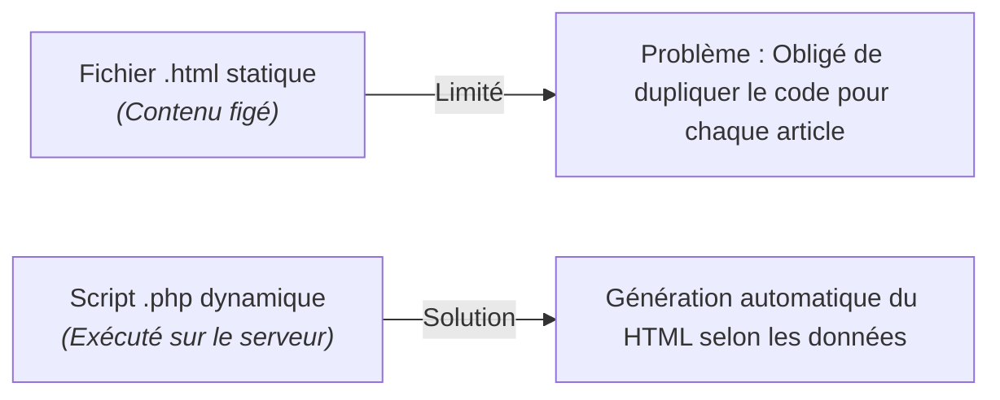

## 1. Objectif

Dans ce tutoriel de **veille technologique** de la session S3, vous allez explorer un nouveau sujet technique clé pour votre formation.

Cette veille technologique a pour but de vous préparer au défi technique de la session suivante : **S4 — Du Web statique au PHP dynamique**.

Vous allez apprendre à :
* comprendre le contexte et l'importance du sujet pour l'évolution de l'application Blog ;
* identifier les notions techniques fondamentales de la technologie étudiée ;
* concevoir votre slide de veille technologique selon les 4 critères imposés ;
* préparer votre restitution orale de 3 minutes.

## 2. Prérequis

* Avoir suivi la session précédente et maîtriser la présentation Google Slides ([T.161.111](/tutos/partage-google-slides/)).
* Être prêt à mener une recherche documentaire en autonomie.

---

## Partie 1 — Contexte & Importance du Sujet

### 1.1. Pourquoi ce sujet est-il crucial pour la suite du projet ?

En session S2 et S3, votre blog est composé de fichiers HTML statiques : pour ajouter un article, vous devez dupliquer manuellement une page HTML entière et retaper le code.

Dès la session S4, vous allez franchir une étape majeure :
* Vous allez installer un **serveur Web local** (comme Apache sous Laragon ou XAMPP).
* Vous allez remplacer les fichiers `.html` par des scripts **PHP** (`.php`).
* Le serveur générera le code HTML **à la volée** lors de chaque visite.
* Vous n'aurez plus besoin de dupliquer les pages : un seul modèle PHP affichera n'importe quel article à partir de données dynamiques.

### 1.2. Schéma de compréhension



---

## Partie 2 — Travail à Réaliser (Autonomie de l'Apprenant)

### 2.1. Votre mission de veille technologique

À l'aide de vos recherches documentaires (documentations officielles, tutoriels de référence), explorez le sujet puis concevez **une seule slide synthétique** dans votre présentation Google Slides de veille technologique.

**Votre slide doit obligatoirement respecter les 4 critères du standard de veille technologique Spartel N1 :**

1. **Nom de la technologie et logo officiel.**
2. **Définition simple (en une seule phrase accessible) :**  
   Expliquez simplement ce qu'est le langage PHP et ce qu'apporte l'exécution de code côté serveur.
3. **Le problème technique concret résolu :**  
   Expliquez pourquoi un site statique HTML devient ingérable dès qu'un blog compte des dizaines d'articles.
4. **Trois mots-clés ou caractéristiques clés :**  
   Exemples : *Serveur local (Apache) — Interpréteur PHP — Génération dynamique*.

### 2.2. Préparation de la restitution orale

Vous présenterez votre slide de veille technologique devant votre formateur ou vos pairs en **3 minutes maximum** :
* **Minute 1 :** Présentez le sujet et donnez votre définition simple.
* **Minute 2 :** Expliquez le problème concret que cela résout pour le projet de Blog.
* **Minute 3 :** Citez vos 3 mots-clés et concluez sur ce que cela vous apporte pour le prochain sprint.

### 2.3. Livrable attendu

Dans votre dépôt annuel de travail, créez le fichier de traçabilité suivant :

```text
veille/technologique/php-dynamique/slide.md
```

**Contenu de votre fichier `slide.md` :**
```markdown
# Veille technologique : Du statique au dynamique avec PHP

- **Auteur :** [Votre Prénom et Nom]
- **Session de réalisation :** S3
- **Session préparée :** S4 — Du Web statique au PHP dynamique
- **Lien public de la slide :** [Coller ici votre URL Google Slides accessible en mode Lecteur]

## Synthèse de ma veille technologique
- **Définition en une phrase :** [Votre phrase simple]
- **Problème résolu pour le projet :** [Pourquoi cet outil ou concept est indispensable]
- **Mes 3 mots-clés :** [Mot-clé 1] — [Mot-clé 2] — [Mot-clé 3]
```

Commitez et poussez votre fichier sur votre dépôt GitHub.

### Critères de réussite

* Votre slide de veille technologique est finalisée sur Google Slides avec un lien public accessible en lecture seule.
* Les 4 critères de contenu sont clairement identifiables en un coup d'œil.
* Vous êtes capable d'expliquer oralement l'intérêt de la technologie en 3 minutes chrono.
* Le fichier `slide.md` est commité dans votre dépôt d'autoformation à l'emplacement indiqué.

---

## Bilan

* Vous avez mené une démarche de **veille technologique** en autonomie pour préparer votre prochaine étape d'apprentissage.
* L'anticipation des concepts techniques vous permet d'aborder les ateliers pratiques avec confiance et curiosité.
* Cette autonomie documentaire constitue une compétence clé tout au long de votre parcours de développeur.

## Glossaire

* **Veille technologique** : Démarche méthodique d'information et d'exploration de technologies pour anticiper les évolutions et les défis d'un projet informatique.
* **PHP (Hypertext Preprocessor)** : Langage de programmation côté serveur permettant de générer des pages Web dynamiques.
* **Serveur Web (ex: Apache)** : Logiciel qui écoute les requêtes HTTP et exécute les scripts PHP avant d'envoyer le résultat au navigateur.
* **Page dynamique** : Page Web dont le contenu HTML est assemblé automatiquement par le serveur au moment de la consultation.
