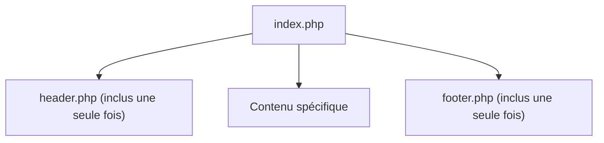

## 1. Objectif

Dans ce tutoriel de **veille technologique** de la session S4, vous allez explorer un nouveau sujet technique clé pour votre formation.

Cette veille technologique a pour but de vous préparer au défi technique de la session suivante : **S5 — Structurer avec des fonctions et des templates**.

Vous allez apprendre à :
* comprendre le contexte et l'importance du sujet pour l'évolution de l'application Blog ;
* identifier les notions techniques fondamentales de la technologie étudiée ;
* concevoir votre slide de veille technologique selon les 4 critères imposés ;
* préparer votre restitution orale de 3 minutes.

## 2. Prérequis

* Avoir suivi la session précédente et maîtriser la présentation Google Slides ([T.161.111](/tutos/partage-google-slides/)).
* Être prêt à mener une recherche documentaire en autonomie.

---

## Partie 1 — Contexte & Importance du Sujet

### 1.1. Pourquoi ce sujet est-il crucial pour la suite du projet ?

En session S4, vous écrivez vos premiers scripts PHP. Mais très vite, un problème de maintenance apparaît :
* L'en-tête (`header`) et le pied de page (`footer`) se répètent à l'identique dans toutes vos pages.
* Si vous devez modifier le menu de navigation, vous êtes obligé de corriger 5 ou 10 fichiers différents.
* Certains calculs (formater une date, calculer un prix) sont recopiés plusieurs fois.

En session S5, vous découvrirez les deux armes absolues de la factorisation :
1. **L'inclusion de templates (`include` / `require`) :** isoler le header et le footer dans des fichiers uniques inclus partout.
2. **Les fonctions PHP :** encapsuler un traitement logique pour l'appeler en une seule ligne.

### 1.2. Schéma de compréhension



---

## Partie 2 — Travail à Réaliser (Autonomie de l'Apprenant)

### 2.1. Votre mission de veille technologique

À l'aide de vos recherches documentaires (documentations officielles, tutoriels de référence), explorez le sujet puis concevez **une seule slide synthétique** dans votre présentation Google Slides de veille technologique.

**Votre slide doit obligatoirement respecter les 4 critères du standard de veille technologique Spartel N1 :**

1. **Nom de la technologie et logo officiel.**
2. **Définition simple (en une seule phrase accessible) :**  
   Expliquez le principe de la modularité logicielle et de la réutilisation de code (principe DRY).
3. **Le problème technique concret résolu :**  
   Expliquez pourquoi le copier-coller de code est la première source de bugs dans un projet Web.
4. **Trois mots-clés ou caractéristiques clés :**  
   Exemples : *Inclusion (require_once) — Fonctions réutilisables — Principe DRY (Don't Repeat Yourself)*.

### 2.2. Préparation de la restitution orale

Vous présenterez votre slide de veille technologique devant votre formateur ou vos pairs en **3 minutes maximum** :
* **Minute 1 :** Présentez le sujet et donnez votre définition simple.
* **Minute 2 :** Expliquez le problème concret que cela résout pour le projet de Blog.
* **Minute 3 :** Citez vos 3 mots-clés et concluez sur ce que cela vous apporte pour le prochain sprint.

### 2.3. Livrable attendu

Dans votre dépôt annuel de travail, créez le fichier de traçabilité suivant :

```text
veille/technologique/fonctions-templates-php/slide.md
```

**Contenu de votre fichier `slide.md` :**
```markdown
# Veille technologique : Modularité et fonctions en PHP

- **Auteur :** [Votre Prénom et Nom]
- **Session de réalisation :** S4
- **Session préparée :** S5 — Structurer avec des fonctions et des templates
- **Lien public de la slide :** [Coller ici votre URL Google Slides accessible en mode Lecteur]

## Synthèse de ma veille technologique
- **Définition en une phrase :** [Votre phrase simple]
- **Problème résolu pour le projet :** [Pourquoi cet outil ou concept est indispensable]
- **Mes 3 mots-clés :** [Mot-clé 1] — [Mot-clé 2] — [Mot-clé 3]
```

Commitez et poussez votre fichier sur votre dépôt GitHub.

### Critères de réussite

* Votre slide de veille technologique est finalisée sur Google Slides avec un lien public accessible en lecture seule.
* Les 4 critères de contenu sont clairement identifiables en un coup d'œil.
* Vous êtes capable d'expliquer oralement l'intérêt de la technologie en 3 minutes chrono.
* Le fichier `slide.md` est commité dans votre dépôt d'autoformation à l'emplacement indiqué.

---

## Bilan

* Vous avez mené une démarche de **veille technologique** en autonomie pour préparer votre prochaine étape d'apprentissage.
* L'anticipation des concepts techniques vous permet d'aborder les ateliers pratiques avec confiance et curiosité.
* Cette autonomie documentaire constitue une compétence clé tout au long de votre parcours de développeur.

## Glossaire

* **Veille technologique** : Démarche méthodique d'information et d'exploration de technologies pour anticiper les évolutions et les défis d'un projet informatique.
* **Modularité** : Pratique consistant à diviser une application en petits modules indépendants et réutilisables.
* **Include / Require** : Instructions PHP permettant d'insérer le contenu d'un fichier dans un autre.
* **Principe DRY** : « Don't Repeat Yourself » : règle de programmation recommandant d'éviter toute duplication de code.
