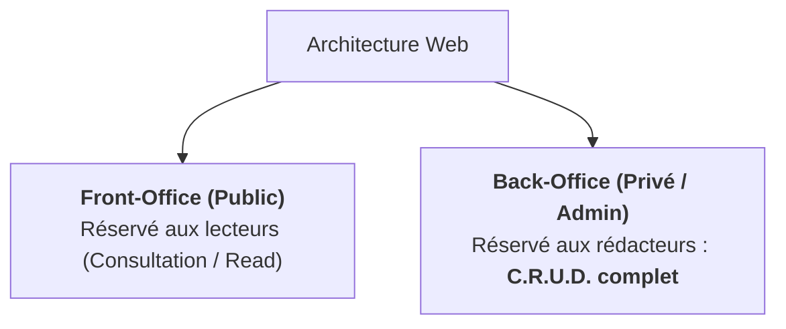

## 1. Objectif

Dans ce tutoriel de **veille technologique** de la session S7, vous allez explorer un nouveau sujet technique clé pour votre formation.

Cette veille technologique a pour but de vous préparer au défi technique de la session suivante : **S8 — Espace Administration et gestion des données**.

Vous allez apprendre à :
* comprendre le contexte et l'importance du sujet pour l'évolution de l'application Blog ;
* identifier les notions techniques fondamentales de la technologie étudiée ;
* concevoir votre slide de veille technologique selon les 4 critères imposés ;
* préparer votre restitution orale de 3 minutes.

## 2. Prérequis

* Avoir suivi la session précédente et maîtriser la présentation Google Slides ([T.161.111](/tutos/partage-google-slides/)).
* Être prêt à mener une recherche documentaire en autonomie.

---

## Partie 1 — Contexte & Importance du Sujet

### 1.1. Pourquoi ce sujet est-il crucial pour la suite du projet ?

Jusqu'à la session S7, votre site Web ne fait qu'afficher des données (Lecture seule pour les visiteurs).
Pour qu'un blog soit fonctionnel, les auteurs et administrateurs doivent pouvoir publier de nouveaux articles, corriger des textes et supprimer les contenus obsolètes.

En session S8, vous allez construire l'architecture d'un **Back-Office d'administration** articulé autour du cycle **CRUD** :
* **C (Create) :** Créer et publier un article.
* **R (Read) :** Consulter la liste des articles gérés dans un tableau récapitulatif.
* **U (Update) :** Modifier un article existant via un formulaire prérempli.
* **D (Delete) :** Supprimer un article après confirmation.

### 1.2. Schéma de compréhension



---

## Partie 2 — Travail à Réaliser (Autonomie de l'Apprenant)

### 2.1. Votre mission de veille technologique

À l'aide de vos recherches documentaires (documentations officielles, tutoriels de référence), explorez le sujet puis concevez **une seule slide synthétique** dans votre présentation Google Slides de veille technologique.

**Votre slide doit obligatoirement respecter les 4 critères du standard de veille technologique Spartel N1 :**

1. **Nom de la technologie et logo officiel.**
2. **Définition simple (en une seule phrase accessible) :**  
   Définissez l'acronyme CRUD et expliquez la différence fondamentale entre le Front-Office et le Back-Office.
3. **Le problème technique concret résolu :**  
   Expliquez pourquoi un utilisateur public ne doit jamais avoir accès aux interfaces de modification ou de suppression de données.
4. **Trois mots-clés ou caractéristiques clés :**  
   Exemples : *CRUD (Create, Read, Update, Delete) — Back-Office — Espace d'administration*.

### 2.2. Préparation de la restitution orale

Vous présenterez votre slide de veille technologique devant votre formateur ou vos pairs en **3 minutes maximum** :
* **Minute 1 :** Présentez le sujet et donnez votre définition simple.
* **Minute 2 :** Expliquez le problème concret que cela résout pour le projet de Blog.
* **Minute 3 :** Citez vos 3 mots-clés et concluez sur ce que cela vous apporte pour le prochain sprint.

### 2.3. Livrable attendu

Dans votre dépôt annuel de travail, créez le fichier de traçabilité suivant :

```text
veille/technologique/crud-backoffice/slide.md
```

**Contenu de votre fichier `slide.md` :**
```markdown
# Veille technologique : Architecture Back-Office et CRUD

- **Auteur :** [Votre Prénom et Nom]
- **Session de réalisation :** S7
- **Session préparée :** S8 — Espace Administration et gestion des données
- **Lien public de la slide :** [Coller ici votre URL Google Slides accessible en mode Lecteur]

## Synthèse de ma veille technologique
- **Définition en une phrase :** [Votre phrase simple]
- **Problème résolu pour le projet :** [Pourquoi cet outil ou concept est indispensable]
- **Mes 3 mots-clés :** [Mot-clé 1] — [Mot-clé 2] — [Mot-clé 3]
```

Commitez et poussez votre fichier sur votre dépôt GitHub.

### Critères de réussite

* Votre slide de veille technologique est finalisée sur Google Slides avec un lien public accessible en lecture seule.
* Les 4 critères de contenu sont clairement identifiables en un coup d'œil.
* Vous êtes capable d'expliquer oralement l'intérêt de la technologie en 3 minutes chrono.
* Le fichier `slide.md` est commité dans votre dépôt d'autoformation à l'emplacement indiqué.

---

## Bilan

* Vous avez mené une démarche de **veille technologique** en autonomie pour préparer votre prochaine étape d'apprentissage.
* L'anticipation des concepts techniques vous permet d'aborder les ateliers pratiques avec confiance et curiosité.
* Cette autonomie documentaire constitue une compétence clé tout au long de votre parcours de développeur.

## Glossaire

* **Veille technologique** : Démarche méthodique d'information et d'exploration de technologies pour anticiper les évolutions et les défis d'un projet informatique.
* **CRUD** : Acronyme désignant les 4 opérations élémentaires sur les données : Create, Read, Update, Delete.
* **Back-Office** : Partie d'une application réservée aux administrateurs pour piloter les contenus et réglages.
* **Front-Office** : Partie publique d'un site Web accessible à tous les internautes.
